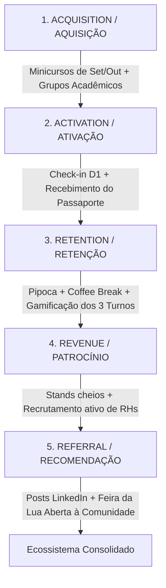

# 📈 GROWTH STRATEGY & UNIT ECONOMICS — SECOMP 2026
**Produto:** SECOMP 2026 (*Construindo Conexões*)  
**Elaborado por:** Morgan (*Product Manager, Requirements Analyst & Growth Strategist*)  
**Status:** Consolidado e Blindado | **Versão:** 1.0.0  

---

## 1. Tese Central de Crescimento & North Star Metric (NSM)

Diferente de eventos comerciais pagos onde a métrica é receita direta, o sucesso da SECOMP 2026 é medido pela **conversão de conexões reais e retenção sustentada nos 3 turnos diários ao longo dos 5 dias**.

### 1.1 A North Star Metric (NSM)
```text
★ NORTH STAR METRIC (NSM):
Taxa de Participação Ativa Qualificada (Passaporte SECOMP Concluído)
Definição: % de alunos inscritos que acumulam ≥ 8 carimbos oficiais entre
           palestras, minicursos, mentorias e dinâmicas até a sexta-feira.

META: ≥ 50% dos inscritos presenciais ativos (superando o histórico médio acadêmico de 25%).
```

### 1.2 Métricas Secundárias de Tração (OMTMs - One Metric That Matters por Turno)
* **Manhã:** Taxa de Ocupação do Auditório Principal (*Meta: ≥ 85% da capacidade*).
* **Tarde:** Volume de Conexões Práticas (*Meta: ≥ 150 mentorias/entrevistas realizadas no pátio e salas*).
* **Noite:** Retenção Noturna Pós-Coffee Break (*Meta: ≥ 70% de permanência dos alunos que estiveram à tarde*).
* **Aluno:** Curso do aluno, carimbos confirmados e nível completo no passaporte. 
* **Shark Tank UTFPR:** Engajamento de Voto Popular via QR Code (*Meta: ≥ 300 votos únicos auditados*).

---

## 2. Unit Economics & Viabilidade Econômica

O evento opera sob o modelo de **Financiamento Misto (Patrocínio Privado + Subsídio Departamental)**, garantindo gratuidade ou taxa simbólica de acesso aos estudantes e alto ROI para as empresas parceiras.

### 2.1 Modelo de Receita & Captação (Inflow)

```text
+-----------------------+---------------------+-------------------+-----------------------------------------+
| FONTE DE RECURSO      | TIPO                | STATUS / CANAL    | CONTRAPARTIDA ENTREGUE                  |
+-----------------------+---------------------+-------------------+-----------------------------------------+
| Cota Diamante         | 3 Cotas Corporativas| TO Brasil, TCS,   | Estande VIP, Jurado Shark Tank,         |localização dos Food Trucks parceiro
|                       | (R$ 3.000 - 5.000)  | ForLogic (Godoy)  | Acesso ao Banco de Talentos, Palestra.  |
+-----------------------+---------------------+-------------------+-----------------------------------------+
| Cota Ouro             | 4 Cotas Regionais   | CyberGuard,       | Mesa na Roda de Talentos (RH),           |
|                       | (R$ 1.500 - 2.500)  | Startups Locais   | Estande Interativo, Logo no Passaporte. |
+-----------------------+---------------------+-------------------+-----------------------------------------+
| Subsídio Departamental| DACOM / UTFPR       | Negociação com    | Financiamento direto dos Coffee-Breaks  |
|                       |                     | Profs. Lucas/Godoy| e concessão dos auditórios/laboratórios.|
+-----------------------+---------------------+-------------------+-----------------------------------------+
| Apoio Institucional   | Incubadora Sprint   | Cesar Dias / Meli | Produção do material gráfico oficial e  |
| & Sebrae              |                     | (Sebrae)          | infraestrutura da banca do Shark Tank.  |
+-----------------------+---------------------+-------------------+-----------------------------------------+
```

### 2.2 Estrutura de Custos Operacionais (Outflow)
* **Coffee-Breaks Estratégicos (5 pausas ao longo da semana):** Principal despesa operacional, 100% subsidiada pelo DACOM e patrocinadores.
* **Pipoca Contínua no Pátio (Tardes):** Custo marginal ultra-baixo (~R$ 150 a R$ 250 em insumos para a semana inteira) com altíssimo impacto de retenção sensorial.
* **Premiações & Troféus (Shark Tank, Ideathon, Sorteio Passaporte):** Viabilizados via permuta e doações das empresas parceiras (periféricos, fones, cursos e troféus 3D).
* **Arena Gamer:** Custo de hardware zero (equipamentos cedidos por centros acadêmicos e voluntários).

### 2.3 Relação LTV / CAC Institucional
* **CAC Estudantil (Custo de Aquisição por Aluno):** Quase nulo (divulgação orgânica em salas de aula, grupos de WhatsApp e minicursos prévios).
* **LTV Institucional (Lifetime Value para a UTFPR):** Fortalecimento dos indicadores de empregabilidade da faculdade, aumento no índice de patentes/startups incubadas na Sprint e estreitamento de parcerias de estágio com Big Techs.

---

## 3. O Funil de Ativação AARRR da SECOMP 2026



### 3.1 Aquisição (Acquisition)
* **Canal 1 (Warm-up Loops):** Minicursos de Setembro (14 e 29) e Outubro (14 e 29). Cada participante já sai pré-credenciado com o kit da SECOMP.
* **Canal 2 (Corredores da Faculdade):** Cartazes com estética Binance (preto fosco e amarelo vibrante) nos murais de laboratório e telas do câmpus.
* **Canal 3 (Comunidades & Professores):** Bonificação de horas complementares (atividades formativas) e incentivo de professores titulares para presença em turnos específicos.

### 3.2 Ativação (Activation)
* **O "Aha! Moment" do Aluno:** Ocorre no primeiro turno de segunda-feira (Keynote de IA com Gustavo Meirelles) ao receber o seu **Passaporte de Carimbos** e ver a **Arena Gamer** montada no pátio.
* **Time-to-Value:** Menos de 5 minutos entre chegar ao câmpus, retirar o crachá e receber o primeiro carimbo.

### 3.3 Retenção (Retention & Anti-Churn Loop)
O maior desafio é o abismo entre o fim da tarde (17h00) e o início da noite (19h00). Estruturamos duas alavancas mecânicas para combater o churn:
1. **O Ímã Alimentar:** O **carrinho de pipoca** das 15h30 às 18h30 desestimulam o aluno a ir para casa ou para a república.
2. **O Circuito Gamer:** Partidas de videogame ocupam exatamente a janela morta das 17h00 às 18h45.

### 3.4 Receita & Retorno para Patrocinadores (Revenue / Partner ROI)
* **Prova de Valor & Employer Branding em Tempo Real:** Patrocinadores não recebem apenas "visibilidade passiva de logo"; recebem **interações corporativas mensuráveis**:
  * **Imersão em Destaque:** O **Túnel 3D Scrollytelling** amplifica a percepção de modernidade da marca (2.0x no foco central com insígnia da cota oficial).
  * **Canal Inbound B2B Ativo:** A modal flutuante de cotas conta com formulário direto de contato integrado à comissão organizadora para fechamento de cotas remanescentes e parcerias futuras.
  * **Recrutamento Ativo e Mensurado:** Candidatos pré-filtrados e entrevistados na Roda de Talentos (slots de 15 min com +2 carimbos).
  * **Engajamento Acadêmico Direto:** Condução de minicursos práticos (ex: TO Brasil) e bancada de júri no Shark Tank UTFPR.

### 3.5 Viral Loops & Reconhecimento Social (Badges LinkedIn)
* **LinkedIn:** Template visual dinâmico disponibilizado no formato feed 1200x630 para alunos postarem *"SECOMP 2026 — EU ESTIVE LÁ"* ou *"NÍVEL MESTRE"*.

---

## 4. Growth Loops Autossustentáveis

### Loop 1: O Efeito Torcida do Shark Tank UTFPR
```text
Inscrição do Projeto no Shark Tank
  ➔ Equipe convoca colegas de turma para lotar o auditório na Quarta-feira
    ➔ Colegas acessam a plataforma para votar via QR Code
      ➔ Descobrem a Roda de Talentos da Quinta-feira e se inscrevem
```

### Loop 2: A Escassez do Passaporte de Premiação
```text
Visualização dos Prêmios na Segunda-feira (kit shampoo, sabonete, ecobag, caneca.)
  ➔ Desejo pelo carimbo de presença
    ➔ Participação ativa em palestras e estandes parceiros
      ➔ Meta de 8+ carimbos atingida na Sexta-feira
```

---

## 5. Matriz de Alinhamento para Handoff da @rosita

Para que a **Product Owner (@rosita)** converta este plano nas User Stories do sistema:

1. **Prioridade 1 de Negócio:** Módulo de Inscrição e Credenciamento (Garantir conversão máxima da fase de Aquisição).
2. **Prioridade 2 de Negócio:** Módulo de Votação Popular do Shark Tank UTFPR (Garantir o loop viral da quarta-feira).
3. **Prioridade 3 de Negócio:** Painel da Grade dos 5 Dias e Minicursos (Garantir a navegação clara dos 3 turnos).
