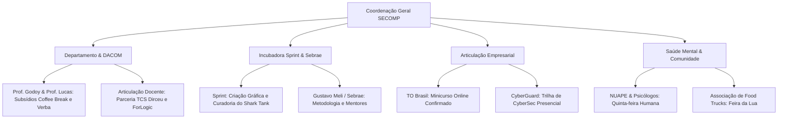

# 🌐 PITCH DE PRODUTO & DIRETRIZ ESTRATÉGICA — SECOMP 2026
**Tema:** *Construindo Conexões (Tecnologia, Comunidade, Impacto & Mercado)*  
**Data da Semana Oficial:** 09 a 13 de Novembro de 2026  
**Ciclo de Warm-up:** Setembro (14 e 29) & Outubro (14 e 29)  
*Elaborado por: Morgan (Product Manager, Requirements Analyst & Growth Strategist)*  
*Status: Aprovado para Distribuição e Captação* | *Versão: 1.0.0*

---

## 1. Visão Executiva & Tese de Negócio

### 1.1 O Desafio
As tradicionais Semanas Acadêmicas de Computação enfrentam gargalos críticos:
* **Desconexão com a Realidade do Mercado:** Abordagens excessivamente teóricas que não dialogam com as exigências contemporâneas de contratação.
* **Evasão e Churn Sequencial:** Alto índice de desistência a partir do terceiro dia do evento devido à fadiga e falta de dinâmicas práticas.
* **Isolamento Técnico (Gap Emocional):** Foco exclusivo em código, negligenciando a saúde mental dos estudantes, inteligência emocional e habilidades interpessoais (*soft skills*).

### 1.2 A Solução: Um Ecossistema Vivo em 3 Turnos
A **SECOMP 2026 — Construindo Conexões** foi concebida sob o modelo de **Experiência Imersiva em 3 Turnos Diários (Manhã, Tarde e Noite)**, integrando tecnologia de ponta, conexão direta com ex-alunos e empresas, empreendedorismo universitário com a **Incubadora Sprint** e acolhimento humano com o **NUAPE**.

O evento se consolida não como um mero ciclo de palestras, mas como uma **plataforma aceleradora de carreiras e protótipos**.

---

## 2. Perfil de Público Ideal (ICP) & Proposta de Valor

| Segmento | Necessidade Principal | Resposta Estratégica da SECOMP |
|---|---|---|
| **Calouros & Alunos de Ciclo Básico** | Ambientação, descoberta de áreas de atuação e visão de futuro. | Minicursos práticos de introdução (Hardware, Python, Web) e Arena Gamer. |
| **Veteranos & Concluintes** | Estágio, contratação, networking e validação de pesquisas/TCCs. | Shark Tank UTFPR, Simulações de Entrevista com RHs e Startup Day. |
| **Comunidade Ex-Alunos (Alumni)** | Retribuição à universidade, mentoria e contratação de talentos. | Mesas Temáticas de Consultoria Express e Painéis de Liderança. |
| **Empresas Patrocinadoras** | Aquisição de talentos (*Talent Acquisition*) e fortalecimento de marca (*Employer Branding*). | Estandes no Startup Day, jurados no Shark Tank e acesso ao Banco de Talentos. |

---

## 3. Estrutura Estratégica: A Jornada Narrativa de 5 Dias

A grade foi desenhada em uma esteira narrativa progressiva: o participante expande sua visão de **Mundo**, entende as demandas do **Mercado**, projeta soluções práticas (**Projetos**), cuida do seu equilíbrio (**Humano**) e projeta o **Futuro**.


[SEGUNDA] ────────► [TERÇA] ────────► [QUARTA] ────────► [QUINTA] ────────► [SEXTA]
 O MUNDO             O MERCADO         OS PROJETOS        O HUMANO           O FUTURO
(Fronteiras e       (Carreira e        (Startups e        (Saúde Mental e   (Ideathon,
 Tendências)         Ex-Alunos)         Shark Tank)        Soft Skills)      Feira da Lua)


---

## 4. Programação Detalhada por Turno (09 a 13 de Novembro)

### 📅 Segunda-Feira: O MUNDO (Visão de Tecnologia & Tendências)
*Objetivo: Despertar a curiosidade intelectual e conectar os estudantes com as fronteiras globais da computação.*

* **Manhã (09h00 - 11h30) | Auditório Principal:**
  * Cerimônia Oficial de Abertura da SECOMP 2026.
  * **Palestra Inaugural:** *"A Revolução da IA Generativa e os Novos Paradigmas do Software"* — Gustavo Meirelles.
* **Tarde (14h00 - 17h00) | Saguão & Pátio Coberto:**
  * **Startup Day Summit:** Feira de estandes interativos com empresas de tecnologia e startups da região.
  * **Abertura Oficial da Arena de Jogos:** Início dos campeonatos de partidas rápidas e área de descompressão.
* **Noite (19h00 - 22h00) | Auditório Principal:**
  * **Painel Executivo:** *"Bastidores das Big Techs & Liderança Técnica Global"* — Mesa-redonda com CTOs e Diretores de Tecnologia (formato híbrido/online com transmissão ao vivo no telão) + Sessão aberta de Q&A.

---

### 📅 Terça-Feira: O MERCADO (Prática, Carreira & Conexão Alumni)
*Objetivo: Desmistificar a transição da faculdade para a vida profissional e restabelecer o elo com egressos de sucesso.*

* **Manhã (09h00 - 11h30) | Auditório Principal:**
  * **Keynote:** *"Arquitetura de Carreira Tech: Navegando pelas Trilhas de Software, Dados, Infraestrutura e Produto"*.
* **Tarde (14h00 - 17h00) | Pátio Coberto:**
  * **Consultorias Express (Café com Ex-Alunos):** Mesas temáticas informais organizadas por especialidade (Dev, Cloud, Cyber, Gestão). Rodadas de 30 minutos de mentoria desarmada regadas a café e troca de experiências.
* **Noite (19h00 - 22h00) | Auditório Principal:**
  * **Palestra Magna:** *"O Frontline da CyberSegurança: Ameaças Reais, Resiliência e Mercado de Defesa Cibernética"* — CyberGuard.

---

### 📅 Quarta-Feira: OS PROJETOS (Startups, Protagonismo & Incubação)
*Objetivo: Fomentar o espírito empreendedor e mostrar como pesquisas, TCCs e ideias de corredor podem virar empresas reais via Incubadora Sprint.*

* **Manhã (09h00 - 11h30) | Auditório Principal:**
  * **Palestra/Painel:** *"Da Faculdade ao Mercado: Transformando Pesquisas e TCCs em Startups Escaláveis"* — Cesar Augusto Dias.
* **Tarde (14h00 - 17h00) | Auditório Secundário / Salas:**
  * **Trilha de Aceleração:**
    * 14h00 - 15h30: *"Como Tirar uma Ideia do Papel: Validação de Problema e Prototipagem Enxuta"*.
    * 15h30 - 17h00: Trilha Tecnológica Aplicada / Workshop de Arquitetura de Software.
* **Noite (19h00 - 22h00) | Auditório Principal:**
  * **SHARK TANK UTFPR:**
    * Competição de Pitches ao vivo (3 min de apresentação + 2 min de perguntas da banca).
    * Participação de projetos de alunos e negócios incubados na **Sprint**.
    * **Banca de Jurados:** Representantes da Incubadora Sprint, investidores/consultores do Sebrae e lideranças empresariais parceiras.
    * **Engajamento:** Votação popular simultânea via QR Code para o troféu *"Destaque da Galera"*.

---

### 📅 Quinta-Feira: O HUMANO (Saúde Emocional, Soft Skills & O Fator Humano)
*Objetivo: Cuidar da integridade emocional dos estudantes, preparando-os psicologicamente para processos seletivos e dinâmicas de equipe.*

* **Manhã (09h00 - 11h30) | Auditório Principal:**
  * **Palestra Interativa:** *"Inteligência Emocional, Síndrome do Impostor e Gestão da Pressão no Meio Tech"*.
  * **Roda de Conversa:** Apoio técnico de psicólogos convidados e equipe do **NUAPE**.
* **Tarde (14h00 - 17h00) | Pátio Coberto & Salas de Apoio:**
  * **Roda de Talentos (Speed Interview):** Simulações individuais de entrevista de emprego de 15 minutos com profissionais de RH de empresas parceiras, com feedback imediato de postura e currículo.
  * Trilha simultânea de palestras sobre comunicação assertiva e negociação para desenvolvedores.
* **Noite (19h00 - 22h00) | Auditório Principal:**
  * **Palestra Magna:** *"Liderança com Empatia e a Gestão de Pessoas em Ambientes de Alta Complexidade"* — Eloah Bueno.

---

### 📅 Sexta-Feira: O FUTURO (Mão na Massa, Competição & Encerramento Festivo)
*Objetivo: Mobilizar a comunidade acadêmica em uma grande maratona criativa e celebrar o encerramento com a comunidade externa.*

* **Manhã (09h00 - 11h30) | Auditório Principal:**
  * **Painel:** *"O Futuro do Trabalho e as Novas Fronteiras da Computação (IA, Computação Quântica e Bioinformática)"*.
* **Tarde (14h00 - 17h30) | Laboratórios & Pátio:**
  * **IDEATHON EXPRESS & GAMEJAM:** Maratona prática e cronometrada de 4 horas para resolução de um desafio real com mentoria rápida no local.
* **Noite (19h00 em diante) | Auditório & Pátio Externo:**
  * **19h00 - 20h30 (Auditório):** Apresentação dos finalistas do Ideathon, cerimônia de premiação, entrega dos troféus e sorteio dos prêmios do **Passaporte SECOMP**.
  * **20h30 em diante (Pátio Externo do Câmpus):** **GRANDE FEIRA DA LUA:** Encerramento festivo com Food Trucks, feirinha de artesanato e projetos estudantis, música ao vivo e integração com a comunidade universitária.

---

## 5. Estratégia de Warm-up: Minicursos Pré-Evento (Setembro & Outubro)

A estratégia de crescimento da SECOMP prevê a ativação precoce da comunidade através de 4 dias dedicados de minicursos técnicos práticos antes da semana oficial, garantindo o engajamento antecipado.

### 5.1 Calendário de Disparo
* **Ciclo 1 (Setembro):** Dias **14** e **29**.
* **Ciclo 2 (Outubro):** Dias **14** e **29**.

### 5.2 Catálogo de Trilhas dos Minicursos

```text
+----------------------+----------------------------------------------+---------------------------+
| TRILHA               | TEMA DO MINICURSO                            | FORMATO / INSTRUTOR       |
+----------------------+----------------------------------------------+---------------------------+
| Inteligência & Dados | • IA & Machine Learning na Prática           | Presencial (Laboratório)  |
|                      | • Power BI & Análise de Dados no Mercado     | Online / TO Brasil        |
+----------------------+----------------------------------------------+---------------------------+
| Infra & Segurança    | • CyberSegurança Operacional e Ethical Hack  | Presencial / CyberGuard   |
|                      | • Containers & Docker para Desenvolvedores   | Presencial (Laboratório)  |
+----------------------+----------------------------------------------+---------------------------+
| Hardware & Sistemas  | • Montagem, Arquitetura e Manutenção de PCs  | Presencial (Bancada)      |
|                      | • Arduino, STM32 e Aplicações em IoT         | Presencial (Lab Maker)    |
+----------------------+----------------------------------------------+---------------------------+
| Desenvolvimento & UI | • Game DEV: Criação de Jogos Digitais        | Presencial (Prep GameJam) |
|                      | • UI/UX Design com Figma para Desenvolvedores| Híbrido                   |
|                      | • Automação e Produtividade com Python       | Presencial (Laboratório)  |
+----------------------+----------------------------------------------+---------------------------+
```

---

## 6. Ecossistema de Ativações: Gamificação, Entretenimento & Gastronomia

Para mitigar a evasão entre turnos e incentivar a permanência contínua dos alunos no câmpus:

### 6.1 Passaporte SECOMP (Loop de Gamificação)
* Todo participante recebe um cartão impresso de carimbos (*Passaporte*).
* **Regras de Pontuação:**
  * Presença em Palestra: 1 carimbo.
  * Participação em Minicurso ou Startup Day: 1 carimbo.
  * Participação na Roda de Talentos ou Mentoria Alumni: 2 carimbos.
  * Disputa na Arena Gamer: 1 carimbo.
* **Retenção:** Alunos que atingirem o limiar de carimbos ganham cupons para concorrer a prêmios de alto valor (periféricos gamers, kits corporativos, bolsas de estudo) no sorteio final de sexta-feira.

### 6.2 Arena Gamer
* Instalação de consoles no pátio com rodadas rápidas de *FIFA*, *Rocket League* e *Street Fighter*.

### 6.3 Gastronomia Estratégica
* **Pipoca Gratuita:** Disponibilizada nas tardes no pátio como elemento sensorial acolhedor e de baixo custo.
* **Coffee-Breaks Patrocinados:** Estruturados entre o fim da tarde (17h00) e o início da noite (19h00) para reter o público diurno para as palestras noturnas.
* **Feira da Lua:** Integração gastronômica noturna externa com Food Trucks parceiros.

---

## 7. Modelo de Parcerias & Proposta de Valor para Patrocinadores

As empresas parceiras não são abordadas por mera filantropia, mas por uma sólida **Proposta de Valor em Recrutamento (Talent Acquisition), Visibilidade (Employer Branding) e Posicionamento Tecnológico**, potencializada pela experiência imersiva no **Túnel 3D Interativo** do Hub Digital:

```text
+-----------------------+-----------------------------------------------------------------------------------+
| COTA OFICIAL          | CONTRAPARTIDAS ENTREGUES À EMPRESA PARCEIRA                                       |
+-----------------------+-----------------------------------------------------------------------------------+
| 🥇 COTA OURO          | • Keynote Magna no Palco Principal da SECOMP                                      |
| (Ex: TO Brasil)       | • Oferecimento de 2 Minicursos Práticos de Engenharia de Dados no pré-evento       |
|                       | • Bancada VIP de Recrutamento na Roda de Talentos (Quinta-feira)                  |
|                       | • Divulgação prioritária em crachás, passaportes, telões e destaque no Túnel 3D   |
+-----------------------+-----------------------------------------------------------------------------------+
| 🥈 COTA PRATA         | • Estande Corporativo no Saguão Maker durante a semana acadêmica                  |
| (Ex: ForLogic Software)| • Mentoria Técnica Oficial nos Squads do Ideathon Express                        |
|                       | • Bancada exclusiva de entrevistas rápidas na Roda de Talentos                    |
|                       | • Inserção de marca no Passaporte Universitário e no Túnel 3D                     |
+-----------------------+-----------------------------------------------------------------------------------+
| 🥉 COTA BRONZE        | • Trilha Presencial Exclusiva de CyberSegurança e Resiliência Digital             |
| (Ex: CyberGuard)      | • Mesa de Atração de Estágios e Trainees na Roda de Talentos                      |
|                       | • Distribuição de brindes institucionais e divulgação nos canais digitais         |
+-----------------------+-----------------------------------------------------------------------------------+
| 🤝 PARCEIRO           | • Desafios Técnicos Reais no Hackathon / Ideathon Express                         |
| ESTRATÉGICO           | • Conexão Direta com Hub de Inovação Internacional e Recrutamento Global          |
| (Ex: TCS)             | • Palestra Temática de Abertura no Arco "O Mercado"                               |
+-----------------------+-----------------------------------------------------------------------------------+
| 🏛️ PARCEIRO          | • Curadoria e Infraestrutura Técnica da Banca do Shark Tank UTFPR                 |
| INSTITUCIONAL         | • Criação do Material Gráfico Oficial, Crachás e Identidade Visual               |
| (Ex: Incubadora Sprint| • Apoio de infraestrutura para prototipação e validação de MVPs                   |
+-----------------------+-----------------------------------------------------------------------------------+
| 🚀 EXPOSITOR          | • Metodologia Oficial de Ideação e Modelagem Lean para os Alunos                  |
| ECOSSISTEMA           | • Mentoria Especializada de Negócios e Credenciamento para Startups Locais        |
| (Ex: Sebrae Paraná)   | • Bancada Institucional de Apoio ao Empreendedorismo Universitário                |
+-----------------------+-----------------------------------------------------------------------------------+
```

Todas as cotas possuem exibição destacada na plataforma oficial com navegação 1 a 1 em profundidade Z, visualização de insígnias oficiais e canal de contato direto e seguro via modal flutuante.

---

## 8. Governança, Stakeholders & Matriz de Operação



### 8.1 Matriz de Papéis e Próximos Passos Imediatos:
1. **Departamento (DACOM / Professores Godoy e Lucas):**
   * Formalizar o repasse/subsídio orçamentário destinado aos Coffee-Breaks.
   * Acionar pontes institucionais com a **ForLogic** e **TCS** (via Prof. Dirceu).
2. **Incubadora Sprint & Sebrae (Gustavo Meli):**
   * Finalizar o fechamento da identidade visual e material promocional com a equipe gráfica da Sprint.
   * Estruturar o edital simplificado de submissão de pitches para o Shark Tank UTFPR.
3. **Equipe de Minicursos:**
   * Alinhar salas, laboratórios e links de transmissão para as sessões de Setembro (14 e 29) e Outubro (14 e 29).
4. **Comissão de Infraestrutura & Lazer:**
   * Mapeamento de consoles, TVs e voluntários para a Arena Gamer.
   * Contatar a organização da Feira da Lua / Food Trucks para autorização de solo na sexta-feira à noite.

---

## 9. Métricas de Sucesso (KPIs & North Star Metric)

* **North Star Metric (NSM):** *Taxa de Conclusão Qualificada do Passaporte SECOMP* (% de alunos que acumularam mais de 8 carimbos ao longo da semana — meta: > 45% dos inscritos ativos).
* **Métrica de Engajamento de Turno:** Manutenção de presença média superior a 70% no auditório no turno da noite.
* **Métrica de Empregabilidade:** Mais de 80 simulações de entrevista executadas na Roda de Talentos da quinta-feira.
* **Métrica de Inovação:** Pelo menos 8 projetos submetidos e avaliados no Shark Tank com avaliação positiva da banca da Sprint e Sebrae.

---
*Documento consolidado para orientação de todas as frentes de trabalho da SECOMP 2026.* 🚀
