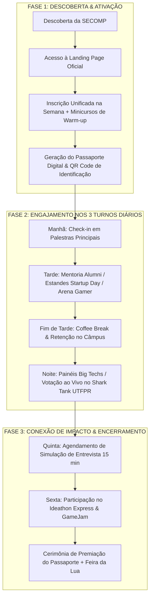

# 📋 PRODUCT REQUIREMENTS DOCUMENT (PRD) — SECOMP 2026
**Produto:** Plataforma Digital & Hub Web da SECOMP 2026 (*Construindo Conexões*)  
**Elaborado por:** Morgan (*Product Manager, Requirements Analyst & Growth Strategist*)  
**Status:** Consolidado para Handoff da Product Owner (@rosita) | **Versão:** 1.0.0  
**Design System Base:** [design.md](file:///home/rai-moratto/Documents/projetos/software-house/software-house/projects/SECOMP/design.md) (Binance High-Voltage Dark System)

---

## 1. Visão Executiva do Produto

A plataforma da **SECOMP 2026** é o hub digital central do evento universitário, projetado para resolver os problemas de fragmentação de informação, evasão de participantes entre turnos e falta de interação prática com patrocinadores e ex-alunos.

A interface opera em **Dark Canvas de alto contraste (`#0b0e11`)**, impulsionada pelo **Amarelo Binance (`#fcd535`)**, tipografia técnica de alta densidade (**BinanceNova / BinancePlex** ou equivalentes) e blocos de layout que transmitem a imponência de um grande evento de tecnologia internacional.

---

## 2. ICP (Ideal Customer Profile) & Personas Centrais

```text
+----------------------------------------------------------------------------------------------------+
| 1. O Aluno Explorador (Calouros / 1º ao 3º período)                                                |
|    • Dor: Insegurança sobre qual área seguir; sensação de estar isolado das matérias práticas.    |
|    • Necessidade: Grade clara de minicursos básicos (Hardware, Python), Arena Gamer e acolhimento. |
+----------------------------------------------------------------------------------------------------+
| 2. O Aluno Protagonista (Veteranos / 4º ao último período)                                         |
|    • Dor: Pressão por estágio, TCC sem validação de mercado, currículo sem diferencial real.       |
|    • Necessidade: Shark Tank UTFPR, simulação com RH na Roda de Talentos e maratona Ideathon.     |
+----------------------------------------------------------------------------------------------------+
| 3. A Empresa Parceira / Recrutador (Ex: ForLogic, TO Brasil, TCS, CyberGuard)                      |
|    • Dor: Dificuldade em filtrar candidatos com aderência cultural e técnica; alto custo de CAC RH.|
|    • Necessidade: Visibilidade de marca (*Employer Branding*), acesso ao banco de talentos e banca. |
+----------------------------------------------------------------------------------------------------+
| 4. A Coordenação & Organizadores (DACOM, Incubadora Sprint, Sebrae)                                |
|    • Dor: Falta de dados de audiência em tempo real, complexidade em coordenar 3 turnos diários.   |
|    • Necessidade: Métricas de check-in, votação instantânea e cronograma confiável.                |
+----------------------------------------------------------------------------------------------------+
```

---

## 3. Jornada Macro de Valor (The Value Journey)

A jornada do participante na plataforma digital é contínua e dividida em três fases estratégicas:



---

## 4. Matriz MoSCoW de Alto Nível (Escopo Macro do Sistema)

> **Nota para @rosita:** Esta matriz delimita as fronteiras macro de negócio para guiar o fatiamento dos Épicos.

### 4.1 Must Have (Crítico para a Operação da SECOMP)
1. **Hero Band & Vitrine de Posicionamento:**
   * Apresentação oficial do tema *"Construindo Conexões"*, datas oficiais (09 a 13 de Nov) e contadores dinâmicos de dias/vagas.
   * Aplicação do componente `hero-band-dark` e tokens primários `#0b0e11` / `#fcd535`.
2. **Grade Dinâmica Interativa dos 5 Dias Temáticos:**
   * Navegação em abas para os 5 arcos: *Segunda (O Mundo)*, *Terça (O Mercado)*, *Quarta (Os Projetos)*, *Quinta (O Humano)* e *Sexta (O Futuro)*.
   * Palestras e minicursos. Filtro de turno por dia. 
   * Palestras e minicursos. Cards por dia: Manha, Tarde e Noite com pré inscrição.
   * Palestras. Filtro por tema: Tecnologia, Gestão, Inovação, Carreira.
   * Minicursos. Filtro por trilha: 4 trilhas de aquisição antecipada (Hardware/IoT, Cloud/Docker, Dados/IA, GameDev).
4. **Módulo de Votação Popular do Shark Tank UTFPR:**
   * Interface mobile-first leve para a plateia do auditório votar no seu pitch favorito em tempo real quando liberado os times.
5. **Hub Imersivo de Parceiros & Sistema de Cotas Oficiais (Túnel 3D):**
   * Apresentação das marcas em **Túnel 3D Scrollytelling** com física inercial de scroll e projeção em profundidade Z.
   * Progressão controlada **1 a 1** no scroll: cada logo recebe foco frontal com ampliação de até **2.0x** e trava sticky estendida até o último parceiro (*Sebrae Paraná*).
   * Hierarquia oficial de 6 Cotas visíveis com insígnias dedicadas: *Cota Ouro*, *Cota Prata*, *Cota Bronze*, *Parceiro Estratégico*, *Parceiro Institucional* e *Expositor Ecossistema*.
   * **Modal Flutuante Acessível de Cota:** Ao clicar no logo ativo ou pressionar `Enter`/`Espaço`, abre popup com descrição completa, lista de contrapartidas/benefícios, tags de tecnologia, link oficial e formulário direto de contato institucional/B2B com a organização.
   * **Garantia de Conforto Visual:** Renderização de partículas e feixes com opacidade atenuada ($\le 0.08$) e ausência de anéis ovais com borda no fundo para evitar ofuscamento.

### 4.2 Should Have (Alto Valor para Retenção & Experiência)
1. **Sistema de Acompanhamento do Passaporte SECOMP:**
   * Exibição visual do passaporte com carimbos.
   * Gamificação do passaporte, com ranking de quem completar o passaporte para concorrer aos sorteios. 
   * Nível do passaporte: novato, aprendiz, graduado, adepto, iniciado ou mestre.
   * Geração de certificado após evento carimbado por token gerado na hora pelo staff e nível alcançado. O token é gerado através de uma lista de presença, que é fechada minutos após o evento e só pode ser usada uma vez.
2. **Módulo de Agendamento da Roda de Talentos (Quinta Humana):**
   * Agendamento de horários (slots de 15 minutos) com os recrutadores e psicólogos do NUAPE.
3. **Mural de Desafios do Ideathon Express:**
   * Edital de regulamento e submissão para times.

2. **Guia Gastronômico da Grande Feira da Lua:**
   * Cardápio digital integrado e localização dos Food Trucks parceiros na sexta-feira.

### 4.4 Won't Have (Fora de Escopo desta Release)
* Sistema complexo de pagamento integrado com gateway bancário (inscrições gratuitas ou tratadas institucionalmente pela universidade).
* Aplicativo nativo em App Store / Google Play (o hub web mobile-first responsive cobre 100% dos requisitos de acesso rápido).
* Criação de rede social própria interna (o networking direciona para LinkedIn, Discord e grupos de WhatsApp oficiais).

---

## 5. Diretrizes de Arquitetura Visual & Mapeamento de Design

O sistema adotará estritamente as definições registradas em `design.md`:

```text
+-----------------------+----------------------------------+-----------------------------------------------+
| COMPONENTE DESIGN.MD  | PROPRIEDADE TÉCNICA              | APLICAÇÃO NA SECOMP              localização dos Food Trucks parceiro             |
+-----------------------+----------------------------------+-----------------------------------------------+
| canvas-dark           | #0b0e11                          | Fundo contínuo de todas as seções principais.  |
| surface-card-dark     | #1e2329                          | Cards de palestras, minicursos e estandes.    |
| primary               | #fcd535 (Binance Yellow)         | Botões de CTA ("Garantir Vaga", "Votar").     |
| on-primary            | #181a20                          | Tipografia preta de alto contraste no botão.  |
| trading-up            | #0ecb81 (Verde)                  | Badges de "Inscrições Abertas" e vagas livres.|
| trading-down          | #f6465d (Vermelho)               | Badges de "Últimas Vagas" e avisos de limite. |
| stat-callout-card     | BinancePlex / 40px Bold          | Contadores numéricos (3 Turnos, 5 Dias, 8+ C.)|
| rounded               | md (6px) a xl (12px)             | Superfícies sólidas e estruturadas.           |
+-----------------------+----------------------------------+-----------------------------------------------+
```

---

## 6. Handoff para Engenharia e Produto

- [x] **Visão de Negócio & Escopo Macro:** Validados por @morgan.
- [ ] **Fatiamento de Épicos & Histórias BDD:** Próxima ação sob responsabilidade de **@rosita**.
- [ ] **Arquitetura Técnica & Frontend:** Handoff posterior para **@rick** e **@carol**.
