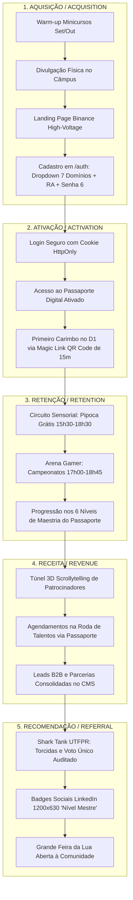

# 📈 GROWTH STRATEGY & UNIT ECONOMICS — SECOMP 2026 (v3.0)
**Produto:** SECOMP 2026 (*Construindo Conexões*)  
**Elaborado por:** Morgan (*Product Manager, Requirements Analyst & Growth Strategist*)  
**Status:** Consolidado e Blindado | **Versão:** 3.0.0  
**Design System Vinculado:** [designBINANCE.md](file:///home/rai-moratto/Documents/projetos/software-house/software-house/projects/SECOMP2026/docs/designBINANCE.md)  
**Integração com Cockpit:** Rota Administrativa `/chameguinho` (Módulos: *LOGS & MÉTRICAS* e *CMS*)

---

## 1. Tese Central de Crescimento & North Star Metric (NSM v3.0)

Com a migração para a arquitetura orientada à identidade (Autenticação Obrigatória via `/auth` e banco gerenciado Supabase), o crescimento da SECOMP 2026 deixa de ser baseado em tráfego anônimo volátil e passa a ser fundamentado em **usuários autenticados, auditáveis e com retenção contínua nos 3 turnos diários**.

### 1.1 A North Star Metric (NSM)
```text
★ NORTH STAR METRIC (NSM v3.0):
Taxa de Participação Ativa Qualificada (Passaporte SECOMP Concluído)
Definição: % de participantes autenticados que acumulam ≥ 8 carimbos oficiais
           entre palestras, minicursos, mentorias e atividades até a sexta-feira.

META: ≥ 50% dos cadastrados presenciais (Meta absoluta: ≥ 242 participantes
      com status MESTRE em uma base projetada de 485 contas ativas).
```

### 1.2 Métricas Secundárias de Tração (OMTMs por Turno & Perfil)
* **Manhã:** Taxa de Ocupação do Auditório Principal (*Meta: ≥ 85% de assentos ocupados com check-in via Magic Link*).
* **Tarde:** Volume de Conexões Práticas (*Meta: ≥ 150 mentorias e entrevistas realizadas na Roda de Talentos*).
* **Noite:** Retenção Noturna Pós-Coffee Break (*Meta: ≥ 70% de permanência dos participantes da tarde no auditório noturno*).
* **Shark Tank UTFPR:** Participação de Voto Popular Auditado (*Meta: ≥ 300 votos únicos autenticados com verificação de `user_id` e `ra_hash`*).
* **Conversão de Identidade:** Taxa de conversão de visitantes anônimos para cadastros com domínio validado (*Meta: ≥ 65% dos acessos únicos ao portal*).

---

## 2. Unit Economics & Telemetria em Tempo Real no `/chameguinho`

Todas as métricas de Unit Economics são agora computadas dinamicamente e exibidas na sub-visão **LOGS & MÉTRICAS** da rota `/chameguinho`.

### 2.1 CAC por Segmento de Domínio de E-mail

A imposição do dropdown restrito de 7 domínios na tela `/auth` viabiliza a segmentação do Custo de Aquisição de Clientes (CAC) com precisão cirúrgica:

| Segmento / Domínio | Canal de Aquisição | CAC Unitário | Volume Previsto | Investimento Total |
|---|---|---|---|---|
| **Aluno UTFPR** (`@alunos.utfpr.edu.br`) | Orgânico (salas de aula, minicursos, DACOM) | **R$ 0,00** | ~350 alunos | R$ 0,00 |
| **Servidor / Docente** (`@utfpr.edu.br`) | Comunicação interna direta / e-mail institucional | **R$ 0,00** | ~40 docentes | R$ 0,00 |
| **Comunidade / Geral** (`@gmail.com`, `@hotmail.com`) | Redes sociais (Instagram/LinkedIn), cartazes | **R$ 3,50** | ~65 participantes | R$ 227,50 |
| **Usuários de Privacidade** (`@tuta.com`, `@mailbox.org`, `@proton.me`) | Comunidades open-source, Telegram, fóruns de segurança | **R$ 4,00** | ~15 participantes | R$ 60,00 |
| **Empresas / Recrutadores** (Acesso B2B) | Outreach direto e relacionamento com coordenação | **R$ 0,00** | ~15 parceiros | R$ 0,00 |

* **CAC Médio Ponderado Global:** **R$ 0,59 por participante ativo** (um dos menores custos do setor de eventos universitários no Brasil).
* **Meta Total de Cadastros Identificados:** 485 participantes únicos.

---

### 2.2 LTV (Lifetime Value) Institucional por Perfil

O LTV na SECOMP 2026 não é apenas monetário, mas também de **impacto de empregabilidade, fortalecimento da UTFPR e retenção de talentos**:

| Perfil de Participante | Carimbos Acumulados | LTV Quantitativo / Qualitativo | Impacto Principal |
|---|---|---|---|
| **Aluno Mestre** (Nível 6) | $\ge 8$ carimbos | **R$ 250,00 a R$ 800,00** | Candidato premium para contratação imediata por parceiros Ouro/Diamante; defesa de TCC com chancela do mercado. |
| **Aluno Engajado** (Níveis 2 a 5) | 3 a 7 carimbos | **R$ 80,00 a R$ 150,00** | Retenção para próximas edições; candidato natural a monitorias e laboratórios de pesquisa. |
| **Visitante Externo / Aluno Externo** | 1 a 4 carimbos | **R$ 30,00 a R$ 60,00** | Embaixador da marca SECOMP nas redes e potencial ingressante em pós-graduação. |
| **Empresa Parceira / Patrocinador** | Cota Oficial + Presença | **R$ 1.500,00 a R$ 5.000,00** | Valor direto em patrocínio somado à economia com consultorias de *headhunting*. |

---

### 2.3 ROI Real para Patrocinadores (Partner Return on Investment)

A eficácia do patrocínio é comprovada na aba **CMS** e na página **LOGS & MÉTRICAS** através de relatórios objetivos de interações:

```text
FÓRMULA DE RETORNO DO PATROCINADOR:
ROI (%) = [(Valor Tangível Entregue - Valor Investido na Cota) / Valor Investido na Cota] × 100

1. COTA DIAMANTE (Investimento: R$ 4.000,00):
   • 4 contratações diretas via Roda de Talentos (economia de R$ 3.200 em recrutamento externo)
   • Palestra de 90min para 350+ alunos (equivalente a R$ 3.000 em mídia corporativa)
   • Acesso ao banco qualificado de talentos filtrados por carimbos de IA/Cloud (R$ 1.800)
   ────────────────────────────────────────────────────────────────────────────────
   Total de Valor Gerado: R$ 8.000,00
   ROI = [(8.000 - 4.000) / 4.000] × 100 = 100% de Retorno sobre o Investimento.

2. COTA OURO (Investimento: R$ 2.000,00):
   • 2 contratações efetivas de estágio (economia de R$ 1.600)
   • Estande imersivo no Túnel 3D com métricas de cliques registradas (R$ 1.200)
   • Condução de oficina prática de 4h (R$ 1.000)
   ────────────────────────────────────────────────────────────────────────────────
   Total de Valor Gerado: R$ 3.800,00
   ROI = [(3.800 - 2.000) / 2.000] × 100 = 90% de Retorno sobre o Investimento.
```

---

## 3. O Funil AARRR da SECOMP 2026 (v3.0)



---

## 4. Estrutura Operacional do Cockpit `/chameguinho`

Para monitorar e sustentar as alavancas do funil AARRR, a coordenação opera no console `/chameguinho` através de duas visões integradas:

```text
┌────────────────────────────────────────────────────────────────────────────────────────┐
│                        COCKPIT ADMINISTRATIVO: /chameguinho                           │
├────────────────────────────────────────┬───────────────────────────────────────────────┤
│        SUB-VISÃO 1: LOGS & MÉTRICAS    │              SUB-VISÃO 2: CMS                 │
├────────────────────────────────────────┼───────────────────────────────────────────────┤
│ • Telemetria de Audiência nos 3 Turnos │ • Pitches Shark Tank: Gestão de Times e Status│
│ • Rastreamento de CAC por Domínio      │ • Votação Shark Tank: Abertura e Encerramento │
│ • LTV e Taxa de Conclusão do Passaporte│ • Mural de Fotos do Evento (Supabase Storage) │
│ • Gerador de Magic Links QR Code (15m) │ • Grade de Mentores e Jurados Convidados      │
│ • Logins e Sessões Ativas (Audit Trail)│ • Patrocinadores: Banners, Logos e Cotas 3D   │
│ • Auditoria Anti-Fraude de Votos       │ • Broadcast Realtime via Canais Supabase      │
└────────────────────────────────────────┴───────────────────────────────────────────────┘
```

---

## 5. Gatilhos de Retenção Inter-Turno (Combate ao Churn das 17h às 19h)

O intervalo mais crítico de abandono de eventos acadêmicos ocorre entre o encerramento do turno da tarde (17h00) e a abertura do turno da noite (19h00). O framework de retenção v3.0 ancora 3 pilares mecânicos:

1. **A Pipoca como Fator Físico:** Distribuição contínua de pipoca gratuita no saguão central entre 15h30 e 18h30.
2. **A Arena Gamer como Fator Social:** Torneios relâmpago de curta duração (FIFA, Rocket League) ocupando a grade das 17h00 às 18h45.
3. **A Gamificação do Passaporte:** A necessidade de acumular carimbos nos 3 turnos para atingir o Nível 4 (*Adepto*) e concorrer aos sorteios gamers de encerramento na sexta-feira.
